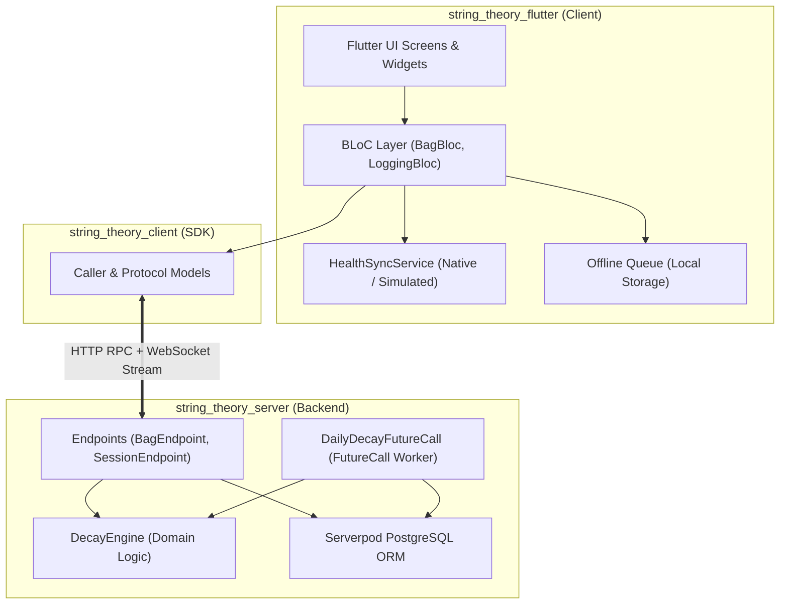

# Architecture Spine — String Theory

## Design Paradigm

String Theory follows a **Layered Reactive Monorepo** paradigm with clean separation across three packages:
* **`string_theory_server` (Backend):** Serverpod 4.0 application hosting PostgreSQL ORM models, RPC Endpoints, WebSocket streaming channels, and scheduled `FutureCalls`.
* **`string_theory_client` (Generated SDK):** Autogenerated typed RPC client, model serializes, and stream listeners. *Never edited manually.*
* **`string_theory_flutter` (Client Application):** Flutter 3.44+ UI governed by the **BLoC pattern** (`flutter_bloc`), consuming Serverpod RPC and streams with offline local queueing.



---

## Invariants & Architectural Decisions

### AD-1: Shared Pure Domain Decay Engine [ADOPTED]
* **Binds:** `FR-8`, `FR-9`, `NFR-1`, `NFR-2`
* **Prevents:** Asynchronous UI lag on court and divergence between client optimistic rendering and backend database calculations.
* **Rule:** The composite decay formula ($70\%$ dynamic playtime hours + $30\%$ static calendar tension creep) is implemented as a pure, deterministic Dart class `DecayEngine`. The Flutter client evaluates `DecayEngine` immediately for optimistic 60fps gauge animations; the Serverpod backend evaluates `DecayEngine` authoritatively upon session persistence and background cron runs.

### AD-2: `StringJob` Entity Model [ADOPTED]
* **Binds:** `FR-4`, `FR-15`, `FR-16`, `FR-17`
* **Prevents:** Semantic ambiguity around racquet stringbeds vs frames and loss of restringing historical provenance.
* **Rule:** A racquet frame is modeled as `Racquet`. Each stringing installation is modeled as `StringJob`. A `Racquet` references one active `StringJob` (`isActive = true`). When a racquet is restrung, the active `StringJob` is marked `isActive = false`, a `RestringEvent` is created, and a new `StringJob` is activated.

### AD-3: Direct Multi-Tenant Scoping (`userId` on All Tables) [ADOPTED]
* **Binds:** `FR-1`, `FR-2`, `FR-20`, `NFR-8`, `NFR-9`
* **Prevents:** Cross-tenant data leaks, SQL multi-table join latency, and background worker lookup overhead.
* **Rule:** All database tables (`Racquet`, `StringJob`, `SessionLog`, `RestringEvent`) must include an indexed `userId: UuidValue` column (since Story 6.3). Serverpod endpoints must strictly filter by `session.authenticated.authUserId` on every operation without relying on indirect joins.
* **Ownership transfer:** The only path that changes a row's `userId` is guest→email linking: `AccountEndpoint.claimGuestBag` verifies a hashed, single-use, 15-minute `GuestClaim` bound to an anonymous-only user, then calls Serverpod `AccountMerger.merge` inside one transaction; the app's `applicationMergeHandler` (registered via `AccountMergeConfig` in `initializeAuthServices`) reassigns the four tables, resolving `(userId, externalWorkoutId)` and primary-racquet conflicts in favour of the kept account.

### AD-4: BLoC State Management (`flutter_bloc`) [ADOPTED]
* **Binds:** `FR-5`, `FR-12`, `FR-14`, `NFR-1`
* **Prevents:** State fragmentation, spaghetti callbacks between WebSockets and UI, and untestable UI logic.
* **Rule:** The Flutter client must use `flutter_bloc` with Unidirectional Data Flow (UDF). All async actions (loading bag, logging sessions, streaming events) enter as `Events` into `BagBloc`, emitting immutable `BagStates`. All business logic must have corresponding unit tests using `bloc_test`.

### AD-5: `HealthSyncService` Strategy Pattern [ADOPTED]
* **Binds:** `FR-11`, `FR-18`, `NFR-6`, `NFR-7`
* **Prevents:** Platform compilation failures on Flutter Web/macOS and inability for hackathon judges to test without wearable hardware.
* **Rule:** The client accesses health data strictly through an abstract `HealthSyncService`. Real mobile targets resolve `NativeHealthSyncService` (HealthKit / Health Connect); Web and Desktop targets resolve `SimulatedHealthSyncService`, enabling the `[🧪 Simulate Workout]` judge controls.

### AD-6: Strict TDD & Patrol E2E Testing Invariant [ADOPTED]
* **Binds:** All stories, `NFR-1`..`NFR-9`
* **Prevents:** Regressions, flaky integration tests, and untestable UI logic.
* **Rule:** All production code must be developed following strict Test-Driven Development (TDD: Red-Green-Refactor). Domain math and BLoCs must have failing unit/bloc tests committed *before* implementation code. E2E acceptance tests must be scripted using `patrol` (`patrol_finders`) to reliably handle native OS permission dialogs and cross-platform UI flows in CI.

---

## Consistency Conventions

| Concern | Convention | Enforced By |
|---|---|---|
| **Schema Definitions** | All entities declared in `.spy.yaml` files inside `string_theory_server/lib/src/models/`. Never edit generated code. | `AGENTS.md`, Serverpod Generator |
| **Database Migrations** | Generated exclusively via Serverpod MCP tools (`create_migration` / `apply_migrations`). | Serverpod CLI / MCP |
| **Naming Conventions** | Tables: snake_case (`racquet`, `string_job`). Models: PascalCase (`Racquet`, `StringJob`). Fields: camelCase (`totalCourtHours`). | Serverpod ORM standards |
| **Dates & Timestamps** | UTC ISO 8601 strings in database (`DateTime`). Formatted to local player timezone in UI presentation layer. | Dart core `DateTime.toUtc()` |
| **Real-Time Stream Channels** | Channel string template: `user_{userId}_bag`. Broadcast events typed as `BagStreamMessage`. | Serverpod Messages API |
| **Error Handling** | Serverpod endpoints throw typed `ServerpodException` or return standardized error payloads. Client BLoCs catch and emit `BagErrorState`. | Serverpod RPC Contract |
| **Testing Standards & CI** | Strict TDD & Multi-Package CI Quality Gate. Backend: `serverpod_test` (embedded PostgreSQL). Client: `bloc_test` & Flutter widget tests. E2E: `patrol`. GitHub Actions CI runs format (`dart format .`), analysis (`flutter analyze --fatal-infos`), and test runners across all 3 workspace packages (`string_theory_server`, `string_theory_client`, `string_theory_flutter`). | Quality Gate, CI Workflows |

---

## Stack Seed

| Layer / Technology | Verified Pinned Version | Role / Justification |
|---|---|---|
| **Dart SDK** | `^3.12.2` | Core language across server, client, and frontend. |
| **Serverpod Backend** | `4.0.3` | Backend server framework with built-in ORM, auth, and streaming. |
| **Serverpod Auth IDP** | `4.0.3` | JWT and guest/email identity provider. |
| **PostgreSQL** | `15+` / Embedded Docker | Authoritative relational data store with full ACID guarantees. |
| **Flutter Framework** | `^3.44.4` | Cross-platform client framework targeting iOS, Android, and Web. |
| **`flutter_bloc`** | `^9.0.0` | Predictable, event-driven state management for UI and streams. |
| **`bloc_test`** | `^10.0.0` | Deterministic unit testing for BLoCs. |
| **`equatable`** | `^2.0.7` | Value-equality for BLoC states and domain models. |
| **`patrol`** | `^3.15.0` | Production-grade Flutter E2E & native dialog testing framework. |
| **`patrol_finders`** | `^2.3.0` | Ergonomic, non-flaky widget finder DSL for Patrol. |
| **`serverpod_test`** | `4.0.3` | Embedded PostgreSQL endpoint integration testing. |

---

## Structural Seed & Serverpod Models

### 1. Data Models (`.spy.yaml`)

#### `string_theory_server/lib/src/models/string_material.spy.yaml`
```yaml
enum: StringMaterialCategory
values:
  - coPoly
  - multifilament
  - syntheticGut
  - naturalGut
```

#### `string_theory_server/lib/src/models/racquet.spy.yaml`
```yaml
class: Racquet
table: racquet
fields:
  userId: int
  name: String
  brand: String?
  model: String?
  isPrimary: bool
  createdAt: DateTime
  updatedAt: DateTime
  activeStringJob: StringJob?, relation
```

#### `string_theory_server/lib/src/models/string_job.spy.yaml`
```yaml
class: StringJob
table: string_job
fields:
  userId: int
  racquetId: int, relation(parent=racquet)
  materialCategory: StringMaterialCategory
  brand: String?
  model: String?
  stringingDate: DateTime
  installedTension: double?
  maxRatedHours: double
  totalCourtHours: double
  currentHealthScore: int
  isActive: bool
  createdAt: DateTime
```

#### `string_theory_server/lib/src/models/session_log.spy.yaml`
```yaml
class: SessionLog
table: session_log
fields:
  userId: int
  racquetId: int, relation(parent=racquet)
  startTime: DateTime
  durationMinutes: int
  courtSurface: String?
  notes: String?
  source: String
  externalWorkoutId: String?
  createdAt: DateTime
indexes:
  session_log_external_id_idx:
    fields: externalWorkoutId
    unique: true
```

#### `string_theory_server/lib/src/models/restring_event.spy.yaml`
```yaml
class: RestringEvent
table: restring_event
fields:
  userId: int
  racquetId: int, relation(parent=racquet)
  stringJobId: int, relation(parent=string_job)
  stringDescription: String
  materialCategory: StringMaterialCategory
  stringingDate: DateTime
  restringDate: DateTime
  finalCourtHours: double
  finalDaysActive: int
  finalHealthScore: int
  createdAt: DateTime
```

#### `string_theory_server/lib/src/models/bag_stream_message.spy.yaml`
```yaml
class: BagStreamMessage
fields:
  eventType: String
  racquetId: int?
  healthScore: int?
  timestamp: DateTime
```

---

### 2. Minimal Source Tree Structure

```text
string_theory/
├── string_theory_server/
│   ├── lib/
│   │   ├── server.dart                   # Server initialization & FutureCall registration
│   │   └── src/
│   │       ├── domain/
│   │       │   └── decay_engine.dart     # Pure composite decay formula implementation
│   │       ├── endpoints/
│   │       │   ├── bag_endpoint.dart     # Racquet & StringJob management
│   │       │   └── session_endpoint.dart # Session logging & real-time broadcast
│   │       ├── future_calls/
│   │       │   └── daily_decay_call.dart # Scheduled nightly tension creep worker
│   │       └── models/                   # .spy.yaml schema files
├── string_theory_client/                 # Autogenerated by serverpod
└── string_theory_flutter/
    └── lib/
        ├── core/
        │   ├── domain/decay_engine.dart  # Shared optimistic decay calculations
        │   └── services/
        │       ├── health_sync_service.dart # Strategy interface
        │       ├── native_health_service.dart
        │       └── simulated_health_service.dart
        ├── features/
        │   ├── bag/
        │   │   ├── bloc/                 # BagBloc, BagEvent, BagState
        │   │   └── screens/              # VirtualBagScreen, RacquetDetailScreen
        │   ├── session_logger/
        │   │   ├── bloc/                 # SessionLoggerBloc
        │   │   └── widgets/              # QuickLogDialog, WorkoutDetectModal
        │   └── restring/
        │       └── widgets/              # RestrungTodaySheet
        └── main.dart
```

---

## Capability → Architecture Map

| Capability / Feature | Implemented In | Governed By |
|---|---|---|
| **Anonymous Guest Auth (`FR-1`–`FR-3`)** | `serverpod_auth_idp_server` + `server.dart` | `AD-3`, Serverpod Auth Module |
| **Virtual Bag & Multi-Racquet (`FR-4`–`FR-7`)** | `BagEndpoint` + `BagBloc` | `AD-2`, `AD-3`, `AD-4` |
| **Composite Decay Engine (`FR-8`–`FR-10`)** | `DecayEngine` + `DailyDecayFutureCall` | `AD-1`, `AD-2` |
| **Session Logging & Health Sync (`FR-11`–`FR-14`)** | `SessionEndpoint` + `HealthSyncService` | `AD-1`, `AD-3`, `AD-5` |
| **Restring Loop & History (`FR-15`–`FR-17`)** | `BagEndpoint.restringRacquet` + `RestringEvent` | `AD-2`, `AD-3` |
| **Judge Workout Simulator (`FR-18`–`FR-19`)** | `SimulatedHealthSyncService` + `DevFAB` | `AD-5` |

---

## Deferred to Post-Hackathon (v1.1)

1. **Shoe & Ball Pressurized Can Models:** Polymorphic `GearItem` table generalization pushed down to v1.1.
2. **Hybrid String Dual-Input Fields:** Separate input fields for Mains vs. Crosses strings.
3. **Audio String Frequency FFT Analyzer:** Microphone tension measurement algorithm.
4. **Third-Party Coach/Pro Shop Sharing:** Multi-user read-only shared gear bags.
