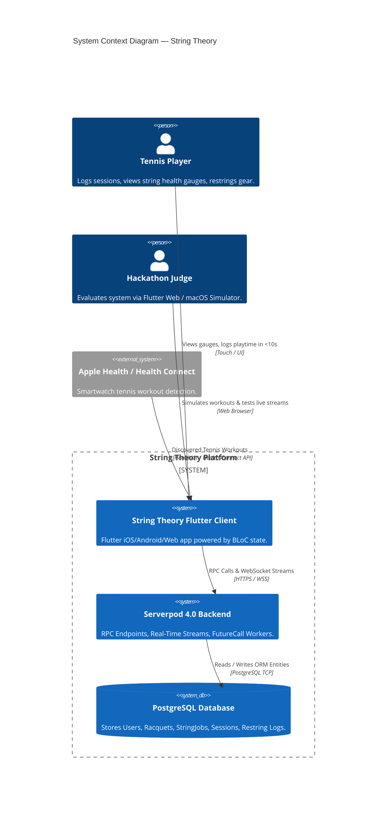
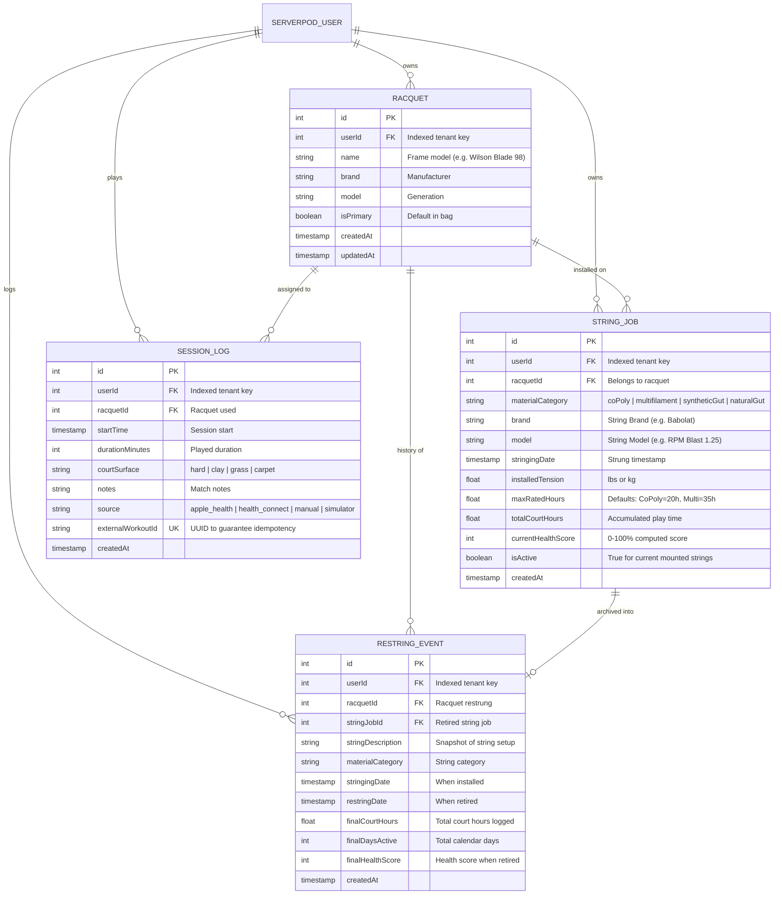
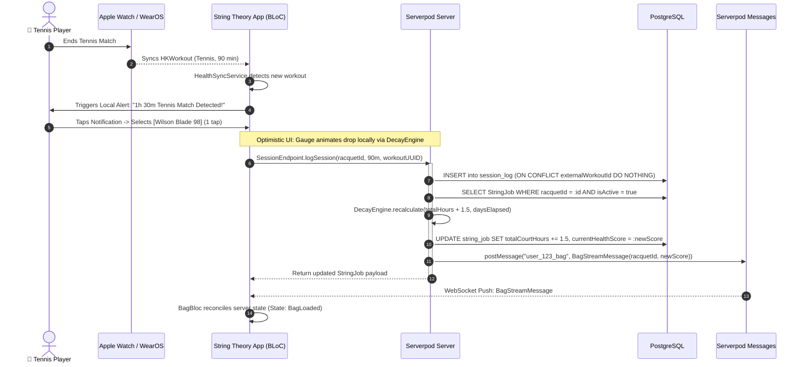
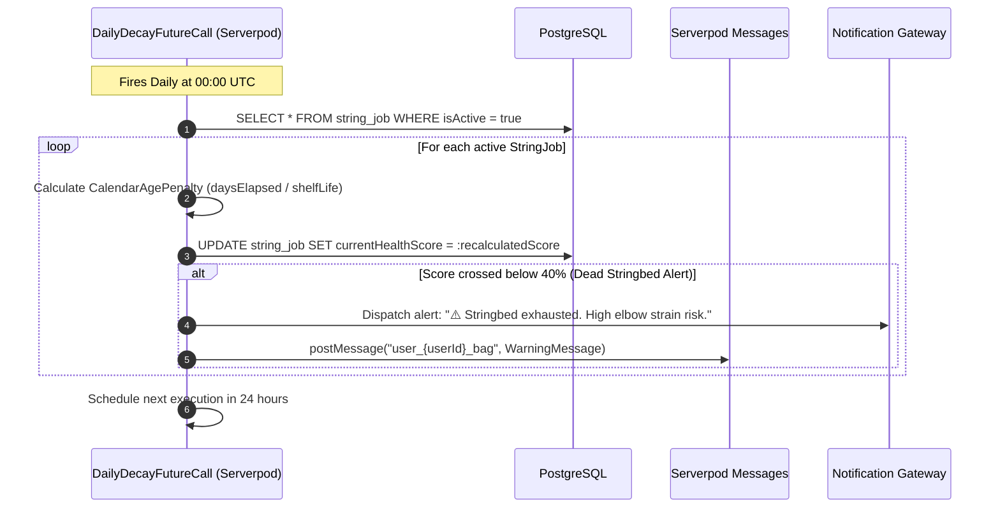
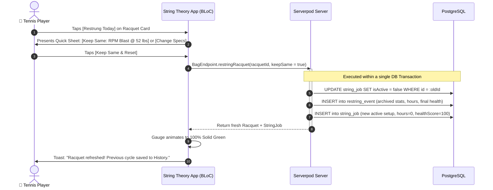
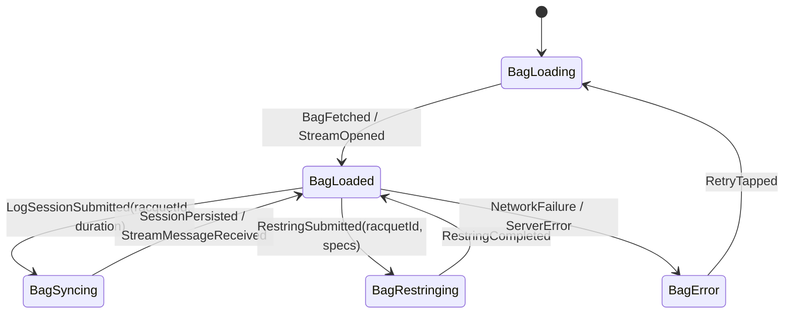

# String Theory — Solution Design & System Architecture
**Built for the Serverpod Hackathon: "Build Something Real"**

## 1. System Context & Architecture Overview

String Theory is designed as a reactive, low-latency mobile and web application that monitors tennis gear degradation and string health in real time. The solution bridges on-device health sensor ingestion with Serverpod's high-performance Dart backend.

---

## 2. Core Entity Relationship Diagram (ERD)

The database schema guarantees row-level multi-tenant security by indexing `userId` across every core table, while maintaining clean 1:1 and 1:N relations.

---

## 3. End-to-End Sequence Diagrams

### 3.1 Post-Match Workout Ingestion & Real-Time Sync Flow

This flow illustrates how an Apple Watch workout flows into String Theory, triggers a 1-tap assignment, and updates client gauges live over Serverpod streaming.

---

### 3.2 Scheduled Background Tension Decay (`FutureCalls`)

How Serverpod handles passive calendar creep while racquets sit inside the tennis bag.

---

### 3.3 The 1-Tap "Restrung Today" Lifecycle Flow

---

## 4. Frontend BLoC Architecture (`string_theory_flutter`)

### Key BLoC Events & States:
* **`BagBloc`:**
  * Events: `LoadBag`, `SessionLogged`, `RestringRequested`, `BagStreamReceived`, `SimulatedWorkoutTriggered`.
  * States: `BagLoading`, `BagLoaded(racquets, activeWorkouts)`, `BagActionInProgress`, `BagError`.
* **Strategy Ingestion:**
  * `HealthSyncService` abstract interface resolves:
    * `NativeHealthService` on physical iOS/Android.
    * `SimulatedHealthService` on Web, Simulator, and Desktop demo environments.

---

## 5. Hackathon Value & Evaluation Highlights

| Feature | Hackathon Demonstration Impact |
|---|---|
| **Zero-Friction Guest Auth** | Judges test immediately with no sign-up wall via Serverpod anonymous authentication. |
| **Instant Real-Time Stream** | Logging a session immediately updates connected web and mobile screens over Serverpod WebSockets. |
| **Automated Decay Worker** | Serverpod `FutureCalls` demonstrate enterprise background task scheduling for tension relaxation. |
| **Judge Workout Simulator** | Floating `[🧪 Simulate Workout]` button lets judges experience the full smartwatch detection loop on web/desktop. |
| **Clean Architecture & Tests** | Comprehensive test suite leveraging `serverpod_test` for backend endpoints and `bloc_test` for Flutter state. |
