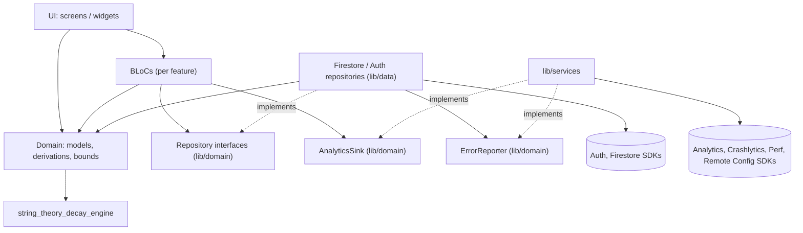
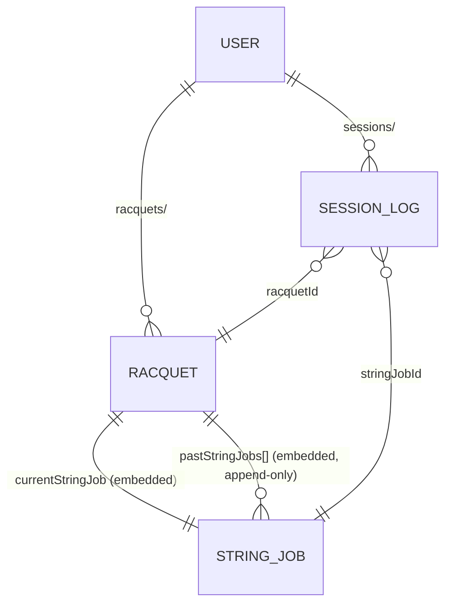
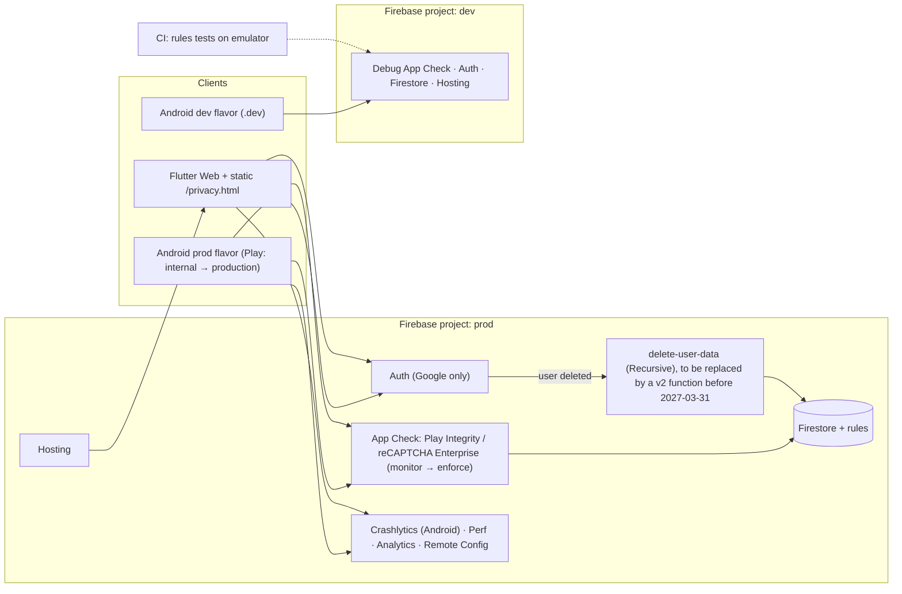

# Architecture Spine — String Theory v1 (Firebase)

## Design Paradigm

A **layered Flutter client** (Flutter's recommended UI / logic / data layering) over a **serverless Firebase backend**. Firestore is the only datastore, and `firestore.rules` is the only server-side check on writes. The only server-side code is the account-deletion trigger (AD-10). Health figures are computed on the device on every read and are never stored.

| Layer | Lives in | May import |
| --- | --- | --- |
| UI (screens, widgets) | `string_theory_flutter/lib/screens/`, `lib/widgets/` | BLoCs, domain, theme |
| Logic (BLoCs) | `lib/bloc/<feature>/` | repository interfaces, domain, `package:clock` |
| Domain | `lib/domain/` | `string_theory_decay_engine` (re-exported) |
| Data (repositories, mappers) | `lib/data/` | domain, `cloud_firestore`, `firebase_auth`, `google_sign_in` |
| Platform services | `lib/services/` | domain interfaces; Analytics, Crashlytics, Perf, Remote Config, App Check SDKs |
| Decay engine | `string_theory_decay_engine/lib/` | nothing (pure Dart) |

## Invariants & Rules



### AD-1 — Layered client; repositories are the only Firestore boundary [ADOPTED]

- **Binds:** all FRs
- **Prevents:** Firestore document shapes defined separately in different BLoCs, duplicated batch logic, BLoC tests that need Firestore, and arguments over which layer is allowed to report telemetry.
- **Rule:**
  - Imports point only in the directions shown in the diagram. Only `lib/data/` imports `cloud_firestore`, `firebase_auth` or `google_sign_in`.
  - Repository interfaces, `ErrorReporter` and `AnalyticsSink` are declared in `lib/domain/`. `lib/data/` and `lib/services/` implement them.
  - **Repositories are the only callers of `ErrorReporter`. BLoCs are the only callers of `AnalyticsSink`.** UI never calls a repository.

### AD-2 — The engine owns material and decay facts; the app owns its models [ADOPTED]

- **Binds:** FR-5..FR-17
- **Prevents:** generated Serverpod types or Firestore types (`Timestamp`, `DocumentSnapshot`) leaking into BLoCs and UI, and a second material enum drifting away from the engine's.
- **Rule:**
  - `string_theory_decay_engine` owns the single `StringMaterial` enum. It also owns the material defaults (`shelfLifeDays`, `defaultMaxHours`) and every derived number: `healthScore`, `tier`, `tensionLossLbs`, `remainingHours`. It exposes them as typed values and takes `now` as a required parameter. The engine no longer has `fromEnum(Enum)` or `other`.
  - `lib/domain/` re-exports the engine and defines the plain immutable `Racquet`, `StringJob`, `SessionLog`, `EndReason` and `failures`.
  - Converting between Firestore maps and domain objects happens only in `lib/data/` mappers.

### AD-3 — One document schema for mappers, rules and validators [ADOPTED]

- **Binds:** FR-5, FR-13, FR-16, FR-18, NFR-7
- **Prevents:** rules rejecting writes the app thinks are valid, mappers dropping documents Firestore holds, and integer/double or `null` mismatches.
- **Rule:** The table below is the wire contract. The same PR must update the mappers, `lib/domain/schema_bounds.dart` (which form validators and domain constructors check before any write), the field-path constants in `lib/data/racquet_fields.dart`, and `firestore.rules`.
  - Optional fields are **absent** when empty. Clearing one uses `FieldValue.delete()`. The only nulls allowed are `currentStringJob.endedAt` and `currentStringJob.endReason`.
  - Numbers travel as `double`. Mappers decode with `(v as num).toDouble()`, and rules check `is number`.
  - A **pending server timestamp** (`null` in a local snapshot) decodes to `clock.now()` and is never treated as a decode failure.
  - Rules enforce `request.auth.uid == uid`, and allow writes under `/users/{uid}/**` only while `/users/{uid}` exists.
  - Rules never compare a client-clock field (`strungAt`, `endedAt`, `playedAt`) with `request.time`. Every other path is denied.

| Path / map | Field | Type & bounds | Req |
| --- | --- | --- | --- |
| `/users/{uid}` (≤10 keys) | `email` | string ≤254 | ✓ |
| | `displayName` | string ≤100 | |
| | `createdAt` | timestamp (server), immutable | ✓ |
| `/users/{uid}/racquets/{racquetId}` (≤15 keys) | `name` | string 1–100 | ✓ |
| | `notes` | string 1–500 | |
| | `isPrimary` | bool | ✓ |
| | `currentStringJob` | StringJob map | ✓ |
| | `pastStringJobs` | list of StringJob, append-only, no cap | |
| | `createdAt` | timestamp (server), immutable | ✓ |
| | `updatedAt` | timestamp (server), `== request.time` | ✓ |
| StringJob map (≤10 keys) | `id` | string 1–64 | ✓ |
| | `material` | `monofilament` \| `multifilament` \| `naturalGut` \| `syntheticGut` | ✓ |
| | `brand` | string 1–80, brand and model in one field | |
| | `tensionLbs` | number 20–80 | |
| | `strungAt` | timestamp (client) | ✓ |
| | `hoursPlayed` | number 0–1000 | ✓ |
| | `maxHours` | number >0, ≤200 | ✓ |
| | `endedAt` | timestamp (client) \| null | ✓ |
| | `endReason` | `dead` \| `broken` \| `manual_restring` \| null | ✓ |
| `/users/{uid}/sessions/{sessionId}` (≤12 keys, create-only) | `racquetId` | string 1–64 | ✓ |
| | `stringJobId` | string 1–64 | ✓ |
| | `durationHours` | number 0.1–24 | ✓ |
| | `playedAt` | timestamp (client) | ✓ |
| | `createdAt` | timestamp (server) | ✓ |
| | `notes` / `surface` / `location` | string 1–500 / 1–40 / 1–120 (not shown in the v1 UI) | |

### AD-4 — Exactly four string materials

- **Binds:** FR-5, FR-9, FR-18
- **Prevents:** the engine (7 values today), the UI (6) and the rules each accepting a different set, and quiet fallbacks that apply the wrong shelf life.
- **Rule:**
  - `StringMaterial` has exactly `monofilament`, `multifilament`, `naturalGut` and `syntheticGut`, stored by name. `monofilament` takes the former co-poly constants (75 days, 20 h).
  - `coPoly`, `kevlar`, `hybrid` and `other` are removed from the engine, the UI and the rules. A hybrid is logged as its dominant material (PRD OQ-2).
  - An unknown stored value makes the mapper report a typed decode failure through `ErrorReporter` and leave that racquet out of the stream.

### AD-5 — Repositories are the only writers; each mutation has one shape and one rule

- **Binds:** FR-5, FR-7, FR-8, FR-13, FR-15, FR-16, FR-18, NFR-4, NFR-5
- **Prevents:** two code paths writing the same document differently, rules that accept one write shape but break another, and writes that can never commit offline.
- **Rule:**
  - These are the only writes, and none of them uses `runTransaction`.
  - Mutations take the domain object the user acted on, for example `logSession(Racquet, double hours)` and `restring(Racquet, StringJob newJob, EndReason)`. That way the archived job and `stringJobId` are exactly what the user saw.
  - `firestore.rules` matches each racquet `update` to exactly one shape below, using `request.resource.data.diff(resource.data).affectedKeys()`.
  - Each shape gets one positive and one negative rules test.

| Method | Write | Rules check |
| --- | --- | --- |
| `addRacquet` | `set` new racquet; `isPrimary: true` only when the bag is empty | full AD-3 racquet validation |
| `updateRacquet` | `update` `name` and/or `notes` (or `FieldValue.delete()`), plus `updatedAt` | affectedKeys ⊆ {name, notes, updatedAt} |
| `deleteRacquet` | `delete` the racquet doc; its sessions are kept | owner only |
| `setPrimary` | `WriteBatch`: target → `isPrimary: true`, and each racquet *currently flagged* → `false`. Every write includes `updatedAt` | affectedKeys = {isPrimary, updatedAt} |
| `logSession` | `WriteBatch`: `set` the session (`stringJobId` = `racquet.currentStringJob.id`), plus `update` `currentStringJob.hoursPlayed: FieldValue.increment(hours)` and `updatedAt` | session: AD-3, create-only. Racquet: affectedKeys = {currentStringJob, updatedAt}; only `hoursPlayed` changed inside it, and it increased |
| `restring` | `update`: `pastStringJobs: FieldValue.arrayUnion([archived])`, plus `currentStringJob` = the new job, plus `updatedAt` | affectedKeys = {pastStringJobs, currentStringJob, updatedAt}. New list size = old size + 1. Only the new last element is validated, and its `id` must equal the old `currentStringJob.id` |

### AD-6 — Offline and multi-device races are accepted, never "fixed" with transactions

- **Binds:** FR-13, FR-15, FR-16, FR-17, PRD OQ-4
- **Prevents:** one builder adding transactions or rejections that silently drop offline writes, while another assumes hours are always attributed exactly.
- **Rule:** These outcomes are accepted:
  - A session that syncs after a restring adds its hours to the new job.
  - A session batch against a racquet deleted elsewhere is rejected as a whole (AD-14 reports it).
  - A second offline restring of the same job is rejected by the AD-5 `id` check.
  - `SessionLog.stringJobId` records which string job a session was played on. String Lab will be built from it.
  - **The archived `hoursPlayed` is what the FR-17 timeline shows.** Readers drop duplicate `pastStringJobs` entries by `id`.

### AD-7 — Health is computed, never stored [ADOPTED]

- **Binds:** FR-9, FR-10, FR-11, NFR-1, SM-C2
- **Prevents:** stale scores, Firestore writes made only to save a score, and screens disagreeing across a tier boundary.
- **Rule:**
  - No document has any health-derived field.
  - `RacquetHealth.of(StringJob, DateTime now)` in `lib/domain/` wraps the engine and is the only place those figures are produced.
  - BLoCs recompute on every racquet snapshot, and when they receive the `AppResumed` event. The app shell sends that event from one `AppLifecycleListener` to every BLoC that shows health.
  - "Now" comes from `package:clock`. There are no timers, Cloud Functions or cron jobs.

### AD-8 — Primary racquet is a per-racquet flag that tolerates conflicts

- **Binds:** FR-8, FR-12, SM-C2
- **Prevents:** a second read to load the bag, readers that crash when racquets have zero or two primaries, and two screens choosing different primaries.
- **Rule:**
  - `isPrimary` lives on the racquet and changes only through `setPrimary`.
  - `resolvePrimary(List<Racquet>)` in `lib/domain/` is the only resolver. It picks the earliest `createdAt` among flagged racquets, or among all racquets if none is flagged. Ties go to the lowest document id.

### AD-9 — Google-only auth behind one repository

- **Binds:** FR-1, FR-2, FR-3, FR-4
- **Prevents:** platform branches in the UI, sign-in flows that `google_sign_in` 7.x rejects, and a user document that never gets created.
- **Rule:** `AuthRepository` is the only way into auth.
  - **Android:** call `GoogleSignIn.instance.initialize(serverClientId: <flavor's web client id>)` exactly once, then `authenticate()`, take the `idToken`, build `GoogleAuthProvider.credential`, and call `signInWithCredential`. Sign-out also calls `GoogleSignIn.instance.signOut()`.
  - **Web:** use `signInWithPopup(GoogleAuthProvider())`.
  - **Re-authentication** follows the same split. If it returns a different account (`user-mismatch`), the action is aborted with a typed failure.
  - **User document:** on every auth state with a user (fresh sign-in or restored session), `ensureUserDoc()` runs before the route gate opens. If the document doesn't exist it creates it with `createdAt`. Otherwise it updates only `email` and `displayName`.

### AD-10 — Account deletion and sign-out teardown

- **Binds:** FR-3, FR-4, UJ-4, NFR-4, NFR-8
- **Prevents:** data left behind after deletion, data recreated by another device after the purge, a frozen bag when the user cancels re-authentication, queued sessions wiped at sign-out, and permission-denied errors reported as crashes.
- **Rule:**
  - **Data purge.** `/users/{uid}` and everything under it are removed by the `delete-user-data` extension, configured with paths `users/{UID}` and delete mode **Recursive**. The client never deletes that data itself.
  - **Before 2027-03-31**, the extension is replaced by a self-owned 2nd-gen `onUserDeleted` function that calls `recursiveDelete` on the same path, because the Firebase Extensions service is retired on that date.
  - **Streams end themselves.** Every repository stream completes without error when the auth uid changes or becomes null. Permission-denied errors that arrive after the change are dropped and never reported. BLoCs never cancel each other's subscriptions.
  - **Deletion order.** Deletion calls `currentUser.delete()` first. On `requires-recent-login` it re-authenticates (AD-9) and retries. If deletion fails, the streams keep running.
  - **Sign-out.** Clearing caches at sign-out (FR-3) means clearing in-memory BLoC state. `clearPersistence()` is never called while writes are pending.
  - **No writes after deletion.** The AD-3 user-document existence check stops other devices from writing after the purge.

### AD-11 — Bootstrap order and APIs

- **Binds:** FR-2, FR-19, FR-21, FR-22, NFR-3, NFR-4, FR-14
- **Prevents:** unverified writes, startup crashes nobody sees, web running without the offline cache or with tabs that don't share it, and a slow Remote Config fetch delaying the first frame.
- **Rule:** `main()` runs inside `runZonedGuarded`. Errors before step 3 are printed to the console only, and that loss is accepted. In order:
  1. `Firebase.initializeApp(options: <flavor>)`.
  2. `FirebaseAppCheck.instance.activate(...)`:
     - `providerAndroid`: `AndroidPlayIntegrityProvider()` in prod, `AndroidDebugProvider()` in dev.
     - `providerWeb`: `ReCaptchaEnterpriseProvider(siteKey)` in prod, `WebDebugProvider()` in dev. It must always be passed, because it has no default.
  3. Crashlytics hooks on `FlutterError.onError` and `PlatformDispatcher.onError`. These are Android only, because Crashlytics has no web support.
  4. `FirebaseFirestore.instance.settings = Settings(persistenceEnabled: true, webPersistentTabManager: WebPersistentMultipleTabManager())`.
  5. Remote Config `setDefaults`, then `activate()`. `fetch()` runs in the background and is never awaited before the first frame.
  6. The auth gate (AD-9 `ensureUserDoc`).

### AD-12 — Environments, Android identity and release

- **Binds:** FR-1, FR-19, FR-20, NFR-8
- **Prevents:** dev builds signing into the wrong project, development testing against real user data, Play rejecting the build, and the dev and prod consoles drifting apart.
- **Rule:**
  - **Projects:** two Firebase projects, `dev` and `prod`, with `.firebaserc` aliases of the same names.
  - **Android identity and flavors:**
    - The Android `applicationId` is `dev.francescoantonioberardi.stringtheory`, built with Gradle `productFlavors` `prod` and `dev` (`applicationIdSuffix ".dev"`).
    - Each flavor has its own `android/app/src/<flavor>/google-services.json` and `lib/firebase_options_<flavor>.dart`, generated by `flutterfire configure`.
    - Builds are `flutter run|build --flavor X --dart-define=FLAVOR=X`. There is no default flavor. `main()` stops immediately if `FLAVOR` is missing, or on Android if it doesn't match `appFlavor`.
    - Each project registers the SHA-1 and SHA-256 fingerprints of its own application id: debug + upload + Play App Signing for prod, debug for dev.
  - **Public config:** these client config files are committed as public identifiers. Service accounts, keystores and deploy tokens live only in GitHub secrets or untracked local files.
  - **App Check:** enforced on Firestore in prod only once the console shows verified requests at or above SM-3's 98%. Until then it runs in monitor-only mode.
  - **Extension config:** the extension's configuration is kept in the repo (`firebase.json` `extensions` plus `extensions/*.env`) and deployed to both projects.
  - **Release:** a signed AAB built locally goes to the Play internal track, then to production.

### AD-13 — How each layer is tested [ADOPTED]

- **Binds:** all stories, AGENTS.md TDD policy
- **Prevents:** BLoC tests that depend on a Firestore fake, untested rules, offline behaviour that has never been exercised, and Patrol or Serverpod tests coming back into CI.
- **Rule:**
  - **BLoCs:** tested with `mocktail` fakes of the repository interfaces and `bloc_test`.
  - **Repositories:** tested with `fake_cloud_firestore`. Running it needs a workspace-root `dependency_overrides: equatable: ^3.0.0`, which is approved and should be removed once `fake_firebase_security_rules`/`cel` accept equatable 3. The first repository story also adds one emulator test with the network turned off, which proves that `increment` and `arrayUnion` are queued and applied.
  - **Rules:** tested with `@firebase/rules-unit-testing` against the emulator in `rules_test/` (npm, outside every `pubspec.yaml`), with one positive and one negative test per AD-5 shape.
  - **Decay engine:** tested with `dart test`.

### AD-14 — A mutation completes when the device accepts it locally

- **Binds:** FR-12, FR-13, FR-15, NFR-4, UJ-1
- **Prevents:** a logger that spins forever while offline on court, analytics that never fire, and server rejections after sync that vanish without anyone knowing.
- **Rule:**
  - Repository mutations return as soon as the write has been applied to the local cache. They start `commit()`/`update()` without awaiting server acknowledgement.
  - A late rejection is sent to `ErrorReporter` (unless it is expected, such as permission-denied after sign-out or `unavailable`) and published on `RacquetRepository.failures` (`Stream<MutationFailure>`), which the bag screen shows as a snackbar.
  - BLoCs report success and fire analytics when the device accepts the write. Pending state comes from `hasPendingWrites` and reaches the domain as `isPendingSync`.
  - Every bound is checked against `schema_bounds.dart` before writing, so a rules rejection means a bug, never a typo.

### AD-15 — How a string job is built

- **Binds:** FR-5, FR-15, FR-16, FR-17
- **Prevents:** different `maxHours` defaults in the form, the restring sheet and the mapper; restrings that are no longer one tap; brand strings longer than the rules allow; and stringing dates that are off by one day.
- **Rule:**
  - `StringJob.maxHours` is never null.
  - Forms fill in `maxHours` from `StringMaterial.defaultMaxHours` (AD-2). Changing the material fills it in again only if the user hasn't edited the field.
  - The UI has one brand/model text field, limited by `schema_bounds`.
  - **Keep Same** copies `material`, `brand`, `tensionLbs` and `maxHours`, sets `strungAt = clock.now()`, and archives with `endReason = manual_restring`.
  - **Change Strings** archives with `manual_restring` by default and offers an optional dead/broken choice. A picked date is stored as that local date at 12:00 local time, converted to UTC.
  - Every new job gets a new `id` (`collection(...).doc().id`).

### AD-16 — Racquet read model

- **Binds:** FR-6, FR-12, FR-14, FR-17
- **Prevents:** several BLoCs each working out primary/health their own way, and two repositories writing racquet field paths that drift apart.
- **Rule:**
  - `RacquetRepository` exposes exactly `watchRacquets()` and `watchRacquet(id)`.
  - `SessionRepository` exposes `watchSessions()` and `logSession(...)`. It writes the racquet document only through the constants in `racquet_fields.dart`.
  - The `bag`, `session_log` and `restring` BLoCs each subscribe to these streams, and derive state only through AD-7 and AD-8's domain functions.

## Consistency Conventions

| Concern | Convention |
| --- | --- |
| Naming | Collections are lowercase plurals; fields follow AD-3. `<Entity>Repository` is the interface (in domain) and `Firestore<Entity>Repository` the implementation (in data). BLoCs: `bag`, `session_log`, `sessions` (history), `restring`, `auth`, `settings`. Exactly one BLoC per feature. |
| IDs | Racquet and session documents use Firestore auto-ids. `StringJob.id` = `collection(...).doc().id`. |
| Time | Firestore `Timestamp` (UTC). Server timestamps only for top-level `createdAt` and `updatedAt`, never inside arrays. Local formatting only in the UI. "Now" = `package:clock`. |
| Errors | Repositories convert `FirebaseException` into typed failures from `lib/domain/failures.dart`. BLoCs turn failures into states and never inspect Firebase error codes. Messages follow the existing `bag_error_messages` pattern. |
| BLoC state | Immutable, using `equatable`. BLoCs never read or change another BLoC's state. Data BLoCs are created under the signed-in subtree of the auth gate. |
| Offline | Firestore persistence is the only offline mechanism; `offline_session_queue.dart` is removed. |
| Telemetry | Event names use snake_case: `sign_in` (with `is_new_user`), `racquet_created`, `session_logged`, `racquet_restrung`. Email and display name never appear in any telemetry. The uid may be used as the Crashlytics user identifier. |
| Remote Config | One service with typed getters. Keys and defaults are exactly `show_ads: false`, `pro_paywall_trigger: false`, `free_racquet_limit: 99`. Nothing in v1 changes behaviour based on them. |
| Platform permissions | The Android manifest declares no health, body-sensor, activity-recognition or fitness permissions (NFR-6). |
| Styling | Only through `ThemeData` / `ThemeExtension` in `lib/theme/` (AGENTS.md). |
| CI | Jobs: `flutter analyze --fatal-infos`, `dart format`, the engine's `dart test`, `flutter test`, rules emulator tests, and `flutter build web`. All of them must pass before a PR merges. |
| Deploy | Run by hand from `main` after CI is green, dev first, then prod: `firebase deploy -P <alias> --only hosting,firestore:rules,firestore:indexes,extensions`. |

## Stack

Versions checked on pub.dev, npm and extensions.dev on 2026-10-23. The full set was test-resolved with the equatable override in place. Each package is added in the first story that needs it, after your approval. All FlutterFire packages come from the same release, `pubspec.lock` is committed, Android `minSdk` stays at 24 or above, and the FlutterFire 6.x line is the fallback.

| Name | Version |
| --- | --- |
| Flutter / Dart | latest stable per AGENTS.md: 3.47.7 / 3.13.5 at authoring (the repo is on 3.44.4; upgrading is a `chore` story) |
| `firebase_core` | `^5.1.0` |
| `firebase_auth` | `^7.0.1` |
| `cloud_firestore` | `^7.1.0` |
| `firebase_app_check` | `^0.5.1` |
| `firebase_crashlytics` | `^6.0.1` |
| `firebase_performance` | `^0.12.1` |
| `firebase_analytics` | `^13.0.1` |
| `firebase_remote_config` | `^7.0.1` |
| `google_sign_in` | `^7.2.0` |
| `flutter_bloc` | `^9.1.1` |
| `equatable` | `^3.0.0` (workspace override, AD-13) |
| `clock` | `^1.1.3` |
| `bloc_test` (dev) | `^10.0.0` |
| `mocktail` (dev) | `^1.0.5` |
| `fake_cloud_firestore` (dev) | `^4.4.0` |
| `@firebase/rules-unit-testing` (npm, Node ≥24.12) | `6.0.0` |
| Extension `firebase/delete-user-data` | `0.1.30` |

## Structural Seed





```text
string_theory/
  firebase.json  .firebaserc          # hosting (string_theory_flutter/build/web, SPA rewrite), rules, indexes, extensions; aliases dev/prod
  firestore.rules  firestore.indexes.json
  extensions/                         # delete-user-data .env per project
  rules_test/                         # npm: @firebase/rules-unit-testing
  string_theory_decay_engine/lib/     # StringMaterial (4), defaults, health/tier/tension/remaining-hours math
  string_theory_flutter/
    android/app/src/{dev,prod}/google-services.json
    web/privacy.html
    lib/
      main.dart                       # AD-11 bootstrap, FLAVOR guard
      firebase_options_dev.dart  firebase_options_prod.dart
      domain/                         # models, failures, schema_bounds, RacquetHealth, resolvePrimary, repo + sink interfaces
      data/                           # Firestore*/Auth repositories, mappers, racquet_fields
      bloc/<feature>/                 # bag, session_log, sessions, restring, auth, settings
      services/                       # AnalyticsSink, ErrorReporter, Remote Config, App Check wiring
      screens/  widgets/  theme/
```

## Capability → Architecture Map

| Capability | Lives in | Governed by |
| --- | --- | --- |
| FR-1..FR-3 Google auth, persistence, sign-out | `data/auth_repository`, `bloc/auth` | AD-9, AD-10, AD-11 |
| FR-4 Account deletion | `bloc/settings`, `data/auth_repository`, extension | AD-10 |
| FR-5..FR-8 Racquets, primary | `data/racquet_repository`, `bloc/bag` | AD-3, AD-4, AD-5, AD-8, AD-15, AD-16 |
| FR-9..FR-11 Decay and tiers | `string_theory_decay_engine`, `domain/RacquetHealth` | AD-2, AD-7 |
| FR-12..FR-14 Quick logger, batch, sync | `data/session_repository`, `bloc/session_log`, `bloc/sessions` | AD-5, AD-6, AD-14, AD-16 |
| FR-15..FR-17 Restring and history | `data/racquet_repository`, `bloc/restring` | AD-5, AD-6, AD-15 |
| FR-18 Security rules | `firestore.rules`, `rules_test/` | AD-3, AD-5, AD-13 |
| FR-19 App Check | `main.dart`, console | AD-11, AD-12 |
| FR-20 Hosting, `/privacy.html` | `firebase.json`, `web/privacy.html` | AD-12, Deploy convention |
| FR-21, FR-22 Telemetry, Remote Config | `lib/services/` | AD-1, AD-11, Telemetry / Remote Config conventions |
| v1 cleanup (NFR-6, PRD non-goals) | One cleanup story. Removes: Serverpod packages, `serverpod_*`, `health`, `shared_preferences`, health services, the offline queue, the dev/judge controls (`SeedSampleBag`, `FastForwardRacquetAge`, Simulate Workout), the Health Connect manifest entries, and the Serverpod/Patrol/health CI jobs. Each removal still needs your explicit approval under AGENTS.md. | Platform permissions and CI conventions |

## Open Questions

- **Consent for Analytics on web (EU visitors).** Do we need a consent banner or Consent Mode before `firebase_analytics` collects data on web? This doesn't block Android launch, and must be decided before the web URL is announced publicly.

## Deferred

- **Replacing the deletion extension** with a self-owned v2 function (AD-10): due before 2027-03-31.
- **Turning on monetization gating** with the existing Remote Config flags: v1.1.
- **FCM push**: v1.2+. `fcmTokens` on `/users/{uid}` is reserved and absent in v1; adding it updates the AD-3 table.
- **The String Lab analytics query**: v1.2+. The data it needs is already guaranteed by AD-5, AD-6 and AD-15.
- **Session history paging size and any composite indexes**: decided in the `sessions` story.
- **Automated deploy and release from CI**: after launch, once manual prod deploys exceed two a week.
- **Billing budget alerts and Firestore PITR/backups**: console setup, done before prod opens to the public.
- **iOS and desktop targets, session editing, and separate mains/crosses strings**: outside v1 scope (PRD non-goals, OQ-2).
