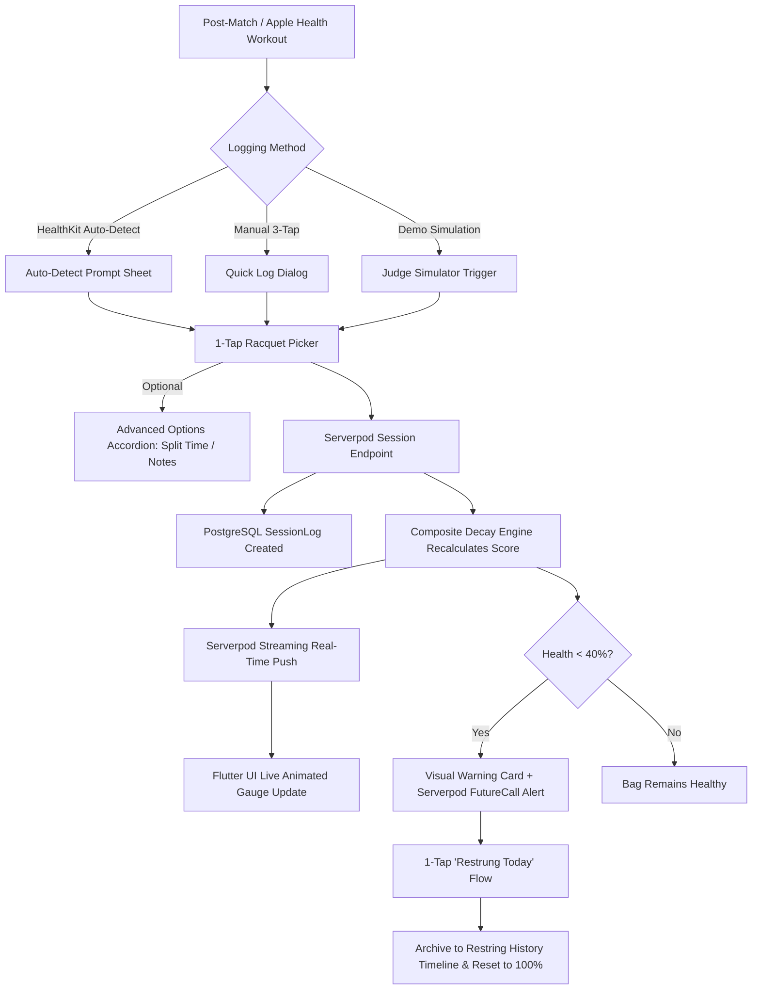

# PRD: String Theory
*Intelligent Tennis Gear Decay & String Health Monitoring*

## 0. Document Purpose

This Product Requirements Document (PRD) establishes the functional, architectural, and quality specifications for **String Theory**, built for the Serverpod Hackathon ("Build Something Real"). It serves as the single source of truth for the System Architect (Winston) and Developer (Amelia). It builds directly upon the [Product Brief](file:///Users/francescoberardi/projects/personal/string_theory/_bmad-output/planning-artifacts/briefs/brief-string_theory-2026-10-01/brief.md) and technical [Addendum](file:///Users/francescoberardi/projects/personal/string_theory/_bmad-output/planning-artifacts/briefs/brief-string_theory-2026-10-01/addendum.md), translating high-level vision into numbered, testable Functional Requirements (`FR-1` through `FR-19`), grounded User Journeys (`UJ-1` through `UJ-4`), and Serverpod-specific architectural non-functional requirements.

---

## 1. Vision

Modern tennis strings—particularly co-polyester—lose elasticity rapidly through court impacts and passive static relaxation while resting in a tennis bag. When strings go "dead," their ball-pocketing capability collapses, and high-frequency shock vibration bypasses the ball, transferring directly into the player's wrist, forearm, and elbow. This is a primary mechanical cause of lateral epicondylitis ("tennis elbow"). Recreational and club players routinely keep strings in their racquets for 6 to 12 months, unaware of the degradation until chronic pain develops or their control vanishes.

**String Theory** is an intelligent, low-friction virtual gear bag that actively monitors string degradation through a composite **Health Score (0–100%)**. By combining automated Apple Health / Health Connect tennis workout detection with an ultra-fast sub-10-second manual quick log, String Theory eliminates the data-entry friction that doomed previous gear tracking apps. 

Powered by **Serverpod** (PostgreSQL ORM, real-time streaming, scheduled background `FutureCalls`, and built-in auth) and **Flutter**, String Theory empowers tennis players to play pain-free, optimize their equipment performance, and restring before injury strikes.

---

## 2. Target User

### 2.1 Jobs To Be Done (JTBD)
* **Functional:** Know exactly how many hours and calendar days are on each of my racquets without writing notes or doing mental math.
* **Health & Safety:** Protect my elbow and shoulder by receiving proactive warnings before dead polyester strings transmit destructive shock.
* **Effortless Capture:** Log my post-match tennis sessions in under 5 seconds—ideally with a single tap after my smartwatch detects my workout.
* **Equipment Maintenance:** Keep a clean history of string models, tensions, and stringing dates to discover which setups perform best and last longest.

### 2.2 Non-Users (v1)
* **Touring Professionals:** Players who restring every 1–2 days and track tension with on-site tournament stringers using ERT 300 / Babolat RDC machines.
* **Multi-Sport Generalists (v1):** Players seeking an all-in-one tracker for squash, badminton, golf, and running. v1 is intentionally laser-focused on tennis strings and racquets.

### 2.3 Key User Journeys

#### UJ-1: Marco Logs Playtime in 3 Seconds After a Match
* **Persona & Context:** Marco (34), intermediate club player, wearing an Apple Watch. Just finished a 90-minute doubles match.
* **Entry State:** Authenticated via background guest session; phone in tennis bag.
* **Path:**
  1. Marco ends his "Tennis" workout on his watch. Within 30 seconds, an in-app sync / local notification fires: *"🎾 1h 30m Tennis Workout detected. Assign to your gear?"*
  2. Marco taps the notification. String Theory opens a bottom sheet showing his registered racquets.
  3. Marco taps `[Wilson Blade 98]`. *(Optional: an "Advanced options" expandable accordion allows splitting time between racquets or adjusting court surface, but Marco does not need it today).*
  4. Marco taps `[Confirm]`.
* **Climax:** The Wilson Blade 98 health gauge smoothly animates downward from 76% (Green) to 67% (Amber), displaying: *"~1.4 lbs tension drop. 11 court hours remaining before dead zone."*
* **Resolution:** Marco pockets his phone. The entire interaction took less than 4 seconds.
* **Edge Case:** If Apple Health is unavailable or permissions are denied, Marco taps a persistent FAB `[+ Log Session]` on the Virtual Bag, selects 1.5 hours and Wilson Blade in 3 taps, and saves.

#### UJ-2: Elena Onboards and Adds Her First Racquet
* **Persona & Context:** Elena (28), recreational player recovering from mild wrist soreness. Downloaded String Theory on recommendation from her coach.
* **Entry State:** First launch of the Flutter app.
* **Path:**
  1. Elena sees a welcoming splash screen highlighting string health and arm protection, with a prominent button: `[Continue as Guest]`.
  2. Elena taps `[Continue as Guest]`. An anonymous Serverpod session is established instantly without email or password forms.
  3. Elena is guided directly into `[Add Your First Racquet]`.
  4. She types "Babolat Pure Drive", selects String Material Category `[Co-Polyester]`, types "Babolat RPM Blast 1.25", and sets Stringing Date (defaults to today; she picks 3 weeks ago). The app automatically pre-populates Manufacturer Max Hours to 20h.
  5. Elena taps `[Save Racquet]`.
* **Climax:** Her Virtual Bag appears with the Babolat Pure Drive card showing an initial calculated Health Score of 88% based on the 3 weeks of calendar shelf-life.
* **Resolution:** An in-context modal politely asks: *"Automatically sync tennis sessions from Apple Health?"* She approves permission. Her bag is ready.

#### UJ-3: David Gets Restrung and Resets the Gauge
* **Persona & Context:** David (42), weekend warrior. His Head Radical racquet has 19 hours of play and 70 days elapsed; its gauge sits at 34% (Red: Dead String Alert).
* **Entry State:** Receives a push notification scheduled by a Serverpod `FutureCall`: *"⚠️ Head Radical stringbed is exhausted (34% Health). Restringing recommended to prevent elbow stress."*
* **Path:**
  1. David takes his racquet to his local pro shop. The stringer puts in fresh Head Lynx strings.
  2. David opens String Theory and navigates to the Head Radical card.
  3. He taps the prominent button: `[Restrung Today]`.
  4. A confirmation sheet asks: *"Restrung with the same setup (Head Lynx 1.25 @ 52 lbs)?"*
  5. David taps `[Keep Same & Reset]`.
* **Climax:** The gauge instantly resets to 100% (Solid Green). The previous cycle is archived into his `[Restring History]` timeline with a summary: *"Active Aug 1 – Oct 2 • 19.2 hrs • 62 days"*.
* **Resolution:** David closes the app, confident his equipment is fresh.

#### UJ-4: Hackathon Judge Explores the End-to-End System in 90 Seconds
* **Persona & Context:** Hackathon Judge reviewing the project submission on Flutter Web or macOS Desktop (no physical Apple Watch attached).
* **Entry State:** App loaded in browser/desktop with sample racquets seeded.
* **Path:**
  1. Judge opens String Theory and sees a visual floating action badge: `[🧪 Demo: Simulate Workout]`.
  2. Judge taps `[Simulate 2h Tennis Match]`.
  3. A simulated Apple Health workout event is triggered through the ingestion pipeline; an instant bottom sheet prompts gear assignment.
  4. Judge assigns the session to "Babolat Pure Aero".
  5. Serverpod real-time stream pushes updated stats; the gauge visibly drops, transitioning from Amber to Red with an arm-injury risk alert.
* **Climax:** Judge taps `[Restrung Today]`, changes string type from Co-Poly to Multifilament, and watches the Serverpod backend persist the change and update the decay curve parameters in real-time.
* **Resolution:** The judge witnesses full-stack Serverpod execution (streaming, ORM, business logic) and seamless Flutter UI in under 2 minutes.

---

## 3. Glossary

* **Racquet:** A physical tennis frame owned by the user (e.g., Wilson Blade 98 v8), represented as a parent gear entity.
* **StringBed:** The current active set of strings installed on a Racquet, characterized by brand, model, material category, stringing date, installed tension, and max rated hours.
* **StringMaterialCategory:** Enum representing string polymer type: `coPoly`, `multifilament`, `syntheticGut`, `naturalGut`. Drives default decay rates and calendar shelf-life.
* **HealthScore:** A normalized integer percentage (0–100) reflecting remaining string elasticity and playability.
* **DynamicHourPenalty:** Decay percentage subtracted based on active court playtime relative to the rated max hours.
* **CalendarAgePenalty:** Decay percentage subtracted based on days elapsed since the stringing date, modeling static polymer creep and tension relaxation.
* **SessionLog:** Record of a tennis session (start time, duration in minutes, court surface, notes) linked to one or more Racquets.
* **RestringEvent:** Historical record generated when a StringBed is retired and replaced, capturing total hours played, total calendar days, and final string specs.
* **VirtualBag:** The primary dashboard aggregating all registered Racquets and equipment for a user.
* **GuestSession:** An anonymous user account authenticated via Serverpod built-in auth, persistent on device, upgradable to full credentials.

---

## 4. Features & Functional Requirements

### 4.1 Guest Onboarding & Authentication
**Description:** Provides zero-friction entry for new users and hackathon judges. Users can immediately manage their bag as a guest. Later, they can optionally link an email or Google login without losing data. Realizes UJ-2.

* **FR-1: Anonymous Guest Session**  
  The system must generate an anonymous authenticated user session upon first launch via Serverpod's built-in auth mechanism without requiring email, password, or third-party OAuth.  
  *Consequences (testable):* Client receives a valid auth key; subsequent API calls authenticate successfully without login prompts.
* **FR-2: Account Linking (Upgrade)**  
  The user can at any time link an email/password identity to their guest account from the Settings screen. (Google linking deferred to v1.1.)  
  *Consequences (testable):* Upon linking, the guest's Racquets, StringJobs, SessionLogs and RestringEvents are reassigned to the email account's `userId` in a single transaction; the bag shows the same racquets and health scores.
* **FR-3: Auth Persistence & Re-hydration**  
  The client must persist the authentication token securely on device storage (Keychain on iOS, Keystore on Android, shared_preferences on Web) and restore the active session on app relaunch.
* **FR-20: Sign-In Screen & Sign-Out**  
  Without a stored session, the app opens on a sign-in screen offering email/password sign-in or sign-up and `[Continue as Guest]`. Signing out from Settings returns to that screen.  
  *Consequences (testable):* Two windows signed into the same email account share one bag and receive live updates; a second email account starts with an empty bag.

---

### 4.2 Virtual Bag & Multi-Racquet Management
**Description:** The core hub where users manage their equipment inventory. Supports multiple racquets, displaying live health statuses and string specs. Realizes UJ-1, UJ-2, UJ-3.

* **FR-4: Add Racquet with String Setup**  
  The user can add a racquet by specifying:
  - Racquet Name / Frame Model (Required, string).
  - String Material Category (Required, Enum: `coPoly`, `multifilament`, `syntheticGut`, `naturalGut`).
  - String Brand & Model (Optional, string; e.g. "Luxilon ALU Power").
  - Stringing Date (Required, DateTime; defaults to current date).
  - Installed Tension (Optional, double; supports lbs or kg).
  - Manufacturer Max Hours (Optional, double; automatically pre-filled with category defaults: Co-Poly = 20h, Multifilament = 35h, Synthetic Gut = 30h, Natural Gut = 50h).  
  *Consequences (testable):* Racquet and active StringBed are persisted in Serverpod ORM; Virtual Bag displays the new card immediately.
* **FR-5: Multi-Racquet Inventory Display**  
  The Virtual Bag screen must display a scrollable list/grid of all registered racquets for the authenticated user, showing frame name, string model, stringing date, total hours logged, and an animated radial or linear Health Score Gauge.
* **FR-6: Racquet Editing & Deletion**  
  The user can update racquet details (frame nickname, photo/icon, notes) or soft-delete a retired racquet.
* **FR-7: Primary / Active Racquet Designation**  
  The user can mark one racquet as "Primary in Bag", causing it to be pre-selected by default in the session logging workflow.

---

### 4.3 Composite Health Score & Decay Engine
**Description:** Evaluates dynamic playing stress and static calendar shelf-life to generate a scientifically grounded Health Score. Realizes UJ-1, UJ-3.

* **FR-8: Composite Decay Calculation**  
  The system must calculate `HealthScore` using the composite formula:
  $$\text{HealthScore} = \max\left(0, 100 - \left(\text{DynamicPenalty} + \text{CalendarPenalty}\right)\right)$$
  Where:
  * $\text{DynamicPenalty} = \left(\frac{\text{HoursPlayed}}{\text{MaxRatedHours}}\right) \times 70$
  * $\text{CalendarPenalty} = \left(\frac{\text{DaysElapsed}}{\text{MaxCalendarShelfLife}}\right) \times 30$
  * `MaxCalendarShelfLife` is determined by StringMaterialCategory:
    * `coPoly`: 75 days (high tension creep and elasticity loss).
    * `multifilament`: 180 days.
    * `syntheticGut`: 180 days.
    * `naturalGut`: 365 days.  
  *Consequences (testable):* A co-poly string with 10 hours played (out of 20h max) and 37.5 days elapsed yields: $100 - (35 + 15) = 50\%$ Health Score.
* **FR-9: Health Status Tiers & Alert Thresholds**  
  The system must categorize Health Scores into three distinct states:
  * **Green (Optimal):** $\ge 70\%$. Normal playability; excellent arm protection.
  * **Amber (Degraded):** $40\% \le \text{Score} < 70\%$. Noticeable tension drop; control reducing.
  * **Red (Dead / High Risk):** $< 40\%$. High shock transfer; restringing recommended.
* **FR-10: Serverpod Scheduled Background Decay (`FutureCalls`)**  
  The Serverpod backend must run a daily scheduled `FutureCall` (or cron job) that scans all active StringBeds, recalculates the `CalendarPenalty` based on current time, updates the cached health score, and flags racquets that crossed into the Red threshold.

---

### 4.4 Session Logging & Workout Ingestion
**Description:** The logging mechanism providing effortless dual entry via smartwatch workout sync and rapid manual logging. Realizes UJ-1, UJ-4.

* **FR-11: Apple Health & Health Connect Workout Detection**  
  The Flutter client must query the OS health subsystem (via HealthKit on iOS, Health Connect on Android) for completed workout sessions with activity type `tennis` recorded since the last sync timestamp.  
  *Consequences (testable):* When a tennis workout is returned, the client surfaces an in-app banner or local push notification prompting gear assignment.
* **FR-12: 1-Tap Gear Assignment Sheet with Progressive Disclosure**  
  Tapping a detected workout opens a modal sheet displaying:
  * Workout metadata (Date, Duration in minutes, estimated calories/heart rate if available).
  * 1-tap selector buttons for registered racquets (with the Primary Racquet highlighted).
  * An expandable **"Advanced options"** accordion that, when opened, enables:
    - Splitting duration across multiple racquets (e.g., 60 min to Racquet A, 30 min to Racquet B).
    - Selecting court surface (`hard`, `clay`, `grass`, `carpet`).
    - Adding freeform session notes.  
  *Consequences (testable):* Selecting a racquet and tapping confirm commits the session in $\le 2$ taps total.
* **FR-13: Sub-10-Second Manual Quick Log**  
  From the Virtual Bag, tapping `[+ Log Session]` opens a modal allowing the user to select duration (with quick-chips: `30m`, `1h`, `1.5h`, `2h`), select racquet, and save in under 10 seconds.
* **FR-14: Real-Time Stream Synchronization**  
  When a session is saved, the Serverpod backend must broadcast an update through a real-time streaming endpoint (`StreamController`) so connected Flutter clients update their gauges and play hours immediately without manual refresh.

---

### 4.5 Restringing Lifecycle & Historical Timeline
**Description:** Closing the loop when strings go dead, resetting the gauge, and preserving historical equipment logs. Realizes UJ-3.

* **FR-15: 1-Tap "Restrung Today" Action**  
  Each racquet card and detail screen must provide a `[Restrung Today]` action. Tapping it opens a quick confirmation sheet:
  * `[Keep Same & Reset]`: Immediately creates a new StringBed with the same brand, model, material, and tension, setting stringing date to today and resetting hours to 0.
  * `[Change Strings]`: Pre-populates the existing specs but allows editing brand, model, material category, tension, or stringing date.
* **FR-16: Historical StringBed Archive**  
  Upon restringing, the retired StringBed is marked as inactive and archived into a `RestringEvent` table recording: total court hours logged, total calendar days active, initial/final health score, and retirement timestamp.
* **FR-17: Restring History Timeline UI**  
  The Racquet Detail screen must provide a "History" tab showing a chronological timeline of past stringbeds with performance stats (e.g., *"Aug 10 – Oct 2 • Babolat RPM Blast 1.25 • 18.5 court hours • 53 days"*).

---

### 4.6 Hackathon Demo Mode & Simulation Tools
**Description:** Dedicated simulation controls ensuring judges and web testers can experience the entire end-to-end loop without physical court activity. Realizes UJ-4.

* **FR-18: One-Click Workout Simulator**  
  The Flutter app must provide an accessible floating badge or dev menu option `[🧪 Simulate Workout]` on web, simulator, and test environments. Tapping it injects a simulated 90-minute tennis workout into the ingestion pipeline, triggering the auto-detection modal.
* **FR-19: Time-Warp Aging Simulator**  
  The dev menu must include a `[Fast-Forward 30 Days]` button for any selected racquet, advancing its stringing date by 30 days to immediately demonstrate calendar decay transitions and warning alerts.

---

## 5. Non-Goals (Explicit)

* **[Non-Goal] Non-Racquet Gear in v1:** Shoes, ball pressurized cans, and overgrips are deferred to v1.1. Data models will maintain polymorphic `GearItem` compatibility, but UI and logic in v1 are strictly racquet/string focused.
* **[Non-Goal] Acoustic String-Tension Plucking:** Microphone-based frequency vibration analysis (FFT) is strictly out of scope for the hackathon MVP.
* **[Non-Goal] Social Feeds & Public Leaderboards:** No friend challenges, public match sharing, or community feeds.
* **[Non-Goal] Pro Shop Commercial Booking:** No integrated booking or e-commerce marketplace for stringing services in v1.
* **[Non-Goal] In-Match Point Tracking:** String Theory does not track point-by-point scores, aces, or unforced errors (unlike SwingVision or TennisKeeper).

---

## 6. MVP Scope Boundary

| Category | In-Scope (Hackathon MVP) | Out-of-Scope (Deferred to v1.1+) |
|---|---|---|
| **Equipment** | Tennis Racquets & StringBeds | Tennis Shoes, Ball Cans, Grips, Bags |
| **Auth** | Serverpod Anonymous Guest + Email sign-in & guest→email linking | Google linking, Apple Sign-In on Web, Enterprise SSO |
| **Logging** | Apple Health / Health Connect sync + 3-tap quick log + Demo Simulator | GPS court geolocation, SwingVision API sync |
| **Decay Engine** | Composite formula (hours + calendar days) for 4 string types | Ambient temperature/humidity sensor adjustments |
| **Lifecycle** | "Restrung Today" 1-tap reset + historical timeline | Local stringer directory & restring job bidding |
| **Backend** | Serverpod ORM, Streaming WebSockets, `FutureCalls` cron | Multi-tenant club management portal |

---

## 7. Success Metrics & Counter-Metrics

### Primary Metrics
* **SM-1 (Sub-10s Logging Adherence):** $> 85\%$ of manual session logs completed in $\le 10$ seconds (measured from dialog open to confirm tap). *Validates FR-12, FR-13.*
* **SM-2 (Auto-Detection Conversion):** $> 70\%$ of auto-detected Apple Health/Health Connect workouts converted into gear logs within 2 taps. *Validates FR-11, FR-12.*
* **SM-3 (Hackathon Demo Completeness):** 100% pass rate for the end-to-end judge journey (Guest Auth $\rightarrow$ Simulate Workout $\rightarrow$ Assign Gear $\rightarrow$ Decay Animation $\rightarrow$ Restrung Reset) in $< 2$ minutes. *Validates FR-1, FR-14, FR-18.*

### Secondary Metrics
* **SM-4 (Multi-Racquet Bag Adoption):** Average of $\ge 1.8$ racquets registered per active user bag. *Validates FR-4, FR-5.*
* **SM-5 (Restring Cycle Archive Rate):** $\ge 80\%$ of racquets reaching $<40\%$ health execute a "Restrung Today" action rather than abandoning the racquet. *Validates FR-15, FR-16.*

### Counter-Metrics (Do Not Optimize)
* **SM-C1 (Notification Fatigue):** Maximum of 1 push alert per day for any racquet in the Red threshold. *Do not spam players to drive artificial engagement.*
* **SM-C2 (Field Clutter):** Advanced options (splitting time, court surface, custom notes) must remain collapsed by default. *Do not expose secondary fields on the primary logging screen.*

---

## 8. Cross-Cutting Non-Functional Requirements (NFRs)

### 8.1 Performance & Latency
* **NFR-1 (UI Responsiveness):** Gauge animation transitions must render at 60 fps without frame drops on standard mobile devices.
* **NFR-2 (Real-Time Sync Latency):** Serverpod streaming updates must reflect on the client within $< 300\text{ ms}$ of session persistence.
* **NFR-3 (Cold Start to Bag):** App cold-start to interactive Virtual Bag screen must be $< 1.2\text{ seconds}$ using local cached state.

### 8.2 Reliability & Offline Resilience
* **NFR-4 (Offline Logging):** If the player is on court without cellular data or Wi-Fi, the Flutter client must queue SessionLogs locally in SQLite/Hive and sync to the Serverpod backend automatically upon network reconnection.
* **NFR-5 (Atomic Restring Operations):** Archiving a retired StringBed and initializing a new active StringBed must execute within a single Serverpod database transaction to prevent orphan racquets.

### 8.3 Privacy & Health Data Governance
* **NFR-6 (Minimal Health Data Ingestion):** String Theory requests *read-only* access strictly for `workout` data (specifically filtering for tennis activity). It does not request or store unrelated biometric data (heart rate ECG, blood glucose, sleep stages, or GPS route coordinates).
* **NFR-7 (Local Health Processing):** Apple Health workout parsing occurs locally on device; only the resulting `SessionLog` (timestamp, duration, gear ID) is transmitted to the Serverpod backend.

### 8.4 Serverpod Architectural Standards
* **NFR-8 (Serverpod CLI & MCP Compliance):** All database entities must be declared in `.spy.yaml` schemas. No manual edits to generated code. Migrations generated via Serverpod MCP tools.
* **NFR-9 (Serverpod Auth Module):** Built-in Serverpod authentication module (`serverpod_auth`) utilized for session security, token management, and guest accounts.

---

## 9. Open Questions & Resolutions

1. **[RESOLVED] OQ-1 (Tension Loss Modeling):** Display Health Score (0–100%) as the primary hero metric, accompanied by secondary estimated tension loss text (e.g. *"Tension down ~1.5 kg / ~3.3 lbs"*) for player clarity.
2. **[RESOLVED] OQ-2 (Hybrid Stringing Setups):** For v1, hybrid setups are categorized by the dominant stringbed material (e.g., Co-Poly). Explicit dual main/cross separate spec inputs are formally deferred to v1.1.

---

## 10. Assumptions Index

* **[ASSUMPTION: §2.3 / UJ-2]** Apple Health and Android Health Connect permissions are requested in-context after adding the first racquet, rather than on the initial splash screen, to maximize permission grant rates.
* **[ASSUMPTION: §4.3 / FR-8]** Calendar decay operates on a maximum shelf-life baseline (75 days for Co-Poly, 180 for Multi, 365 for Gut) which accounts for 30% of total decay, while court playtime accounts for 70%.
* **[ASSUMPTION: §4.4 / FR-12]** The common 90% use case is playing with a single racquet for the entire workout; splitting time across racquets is handled via an expandable "Advanced options" accordion.
* **[ASSUMPTION: §4.6 / FR-18]** Hackathon judges will test on web and desktop environments where real Apple Watch hardware is absent, making a simulated workout generator mandatory for a successful submission.
