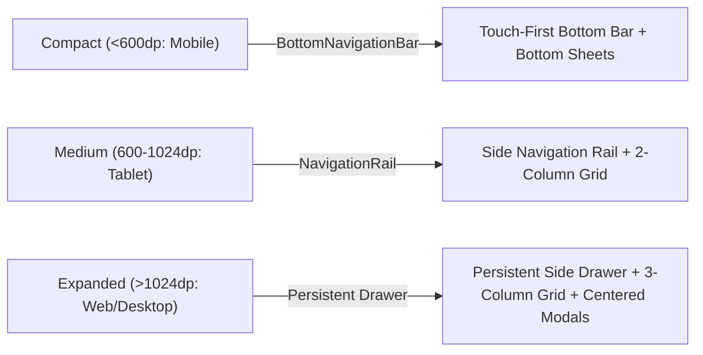

# String Theory Experience Specifications

## 1. Foundation & Platform Architecture

String Theory is a **multi-surface Flutter application** targeting mobile phones (iOS / Android) and desktop/web browsers. The interface adapts dynamically across three responsive breakpoints:



### Platform Adaptation Matrix:
* **Mobile (Touch):** Bottom navigation bar, modal bottom sheets (`showModalBottomSheet`), large touch targets ($\ge 48\text{dp}$), pull-to-refresh.
* **Tablet / iPad:** Left-side `NavigationRail`, 2-column card grid, split master-detail view for racquet logs.
* **Desktop / Web (Mouse & Keyboard):** Full navigation drawer, multi-column grid, dialog modals (`showDialog`), hover state lighting, and keyboard accelerators (`L` for Log, `N` for New, `S` for Simulate, `Esc` to close).

---

## 2. Information Architecture & Navigation

```text
String Theory
├── 🔑 Sign-In Screen (no stored session)
│   ├── Email Sign-In / Sign-Up (verification code)
│   └── [Continue as Guest]
├── 🎾 Virtual Bag (Root / Home Screen)
│   ├── Floating Demo FAB: [🧪 Simulate Workout]
│   ├── Quick Action FAB: [+ Log Session]
│   ├── Racquet Card List / Grid
│   │   ├── Radial Health Gauge (Tap to view details)
│   │   ├── Restrung Today Action (Opens Quick Sheet)
│   │   └── Quick Log Action
│   └── Empty State: [Add Your First Racquet]
├── 📋 Session History
│   ├── Historical Session Feed (Date, Duration, Racquet, Surface)
│   └── Filter by Racquet Chips
├── 🔍 Racquet Detail Screen
│   ├── Full Frame & String Specs
│   ├── Remaining Court Hours & Tension Decay Estimator
│   └── Restringing Timeline History
└── ⚙️ Settings & Account
    ├── Guest: Account Banner -> [Continue with Email] (links & keeps bag) · Email user: account email
    ├── [Sign Out] -> Sign-In Screen
    ├── Apple Health / Health Connect Sync Status
    └── App Version & Hackathon Attribution
```

---

## 3. Voice & Tone (Microcopy)

* **Preventive, not Alarming:** Frame string wear as equipment care and arm health, not a catastrophic failure.
  * *Do:* *"Strings are losing elasticity (~1.4 lbs tension drop). Restringing recommended soon to protect your elbow."*
  * *Don't:* *"DANGER: Stringbed destroyed! Your elbow is at severe risk!"*
* **Brevity First:** Players check String Theory while walking off court or wiping sweat with a towel. Use short, scannable phrases.
  * *Do:* *"1h 30m match logged • Wilson Blade at 67%"*
  * *Don't:* *"Your tennis session of ninety minutes duration has been successfully synchronized to the PostgreSQL server."*
* **Celebratory Maintenance:** Celebrate fresh restrings!
  * *Do:* *"Fresh stringbed mounted! Restrung to 100% health."*

---

## 4. Key Component Behaviors

### 4.1 The Progressive Disclosure Quick-Log Sheet
To keep post-match logging under 4 seconds while supporting deep customizability:
1. **Default State (Collapsed):**
   * Top bar shows detected or entered time: `[1h 30m]` (tap to change).
   * Horizontal selector displays user's racquets, pre-selecting the "Primary" racquet.
   * Single prominent CTA: `[Confirm & Save]`.
   * Secondary flat button: `[+ Advanced Options (Split time, surface, notes)]`.
2. **Expanded State (On Tap):**
   * Accordion smoothly expands downward.
   * Enables time splitting (e.g. `Racquet A: 60m`, `Racquet B: 30m`).
   * Surface picker chips: `[Hard]` `[Clay]` `[Grass]` `[Carpet]`.
   * Match notes text area.

### 4.2 The "Restrung Today" 1-Tap Sheet
When a racquet reaches the red threshold, tapping `[Restrung Today]` opens an immediate decision sheet:
* **Option 1 (`[Keep Same & Reset]`):** Instant 1-tap reset to 100% today with previous specs.
* **Option 2 (`[Change Specs]`):** Expands brand, model, tension, and material dropdowns for players changing strings.

---

## 5. State Patterns & Edge Cases

| State | Visual Treatment | User Action / Recovery |
|---|---|---|
| **Empty Bag** | Friendly empty bag illustration with tennis balls; CTA: `[Add Your First Racquet]`. | Guides into 2-step setup. |
| **Syncing / In-Flight** | Shimmer pulse on affected racquet card; subtle spinner inside gauge center. | Background optimistic update; no blocking spinner. |
| **Dead Strings (<40%)**| Card receives `healthCriticalBg` (`#2A1416`), 1px red outline, and badge: *"Dead Stringbed"*. | Prominent `[Restrung Today]` button. |
| **Offline Mode** | Banner: *"Working Offline — Sessions queued locally"*. | Automatically drains queue upon Serverpod reconnection. |
| **Health Permission Denied**| Card in Settings: *"Enable Apple Health for automatic tennis workout detection"*. | Deep-link button to OS Settings. |

---

## 6. Accessibility Floor

* **Touch Targets:** All interactive icons and buttons maintain $\ge 48\times 48\text{dp}$ touch boundaries.
* **Color Blindness Support:** Critical states never rely on color alone:
  * Green includes checkmark `✓ Optimal`.
  * Amber includes dash `~ Caution`.
  * Red includes triangle `⚠️ Restring`.
* **Dynamic Type:** All text scales with system accessibility font scaling up to $200\%$ without clipping.
* **Screen Reader Semantics:** The Radial Gauge carries explicit semantic labeling: *"Wilson Blade 98: String health 84 percent, 12 hours played, 4 hours remaining until dead zone."*
